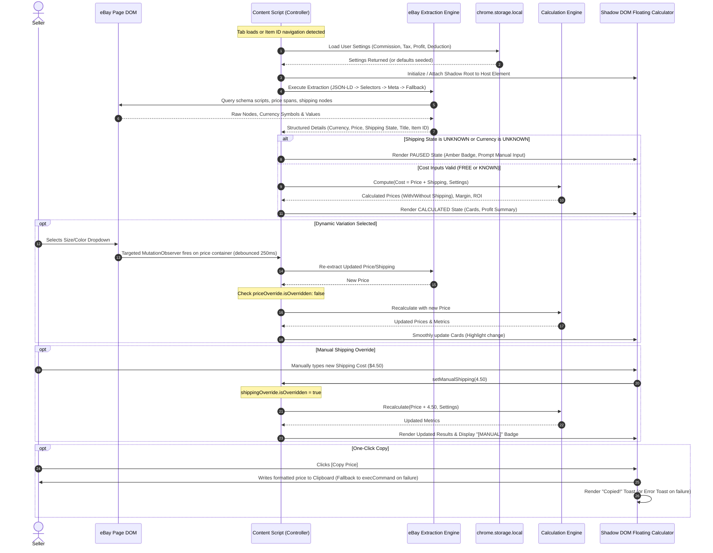
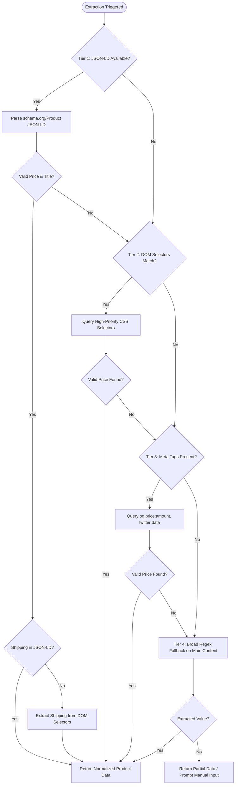

# Technical Architecture Document: eBay to Amazon Profit Calculator

## 1. Executive Architectural Overview

The **eBay to Amazon Profit Calculator** is a modular, event-driven, client-only Google Chrome extension architected under the **Manifest V3** specification. It follows a clean architecture pattern where core business math, DOM parsing heuristics, UI presentation, and persistent storage are decoupled into isolated modules.

```mermaid
graph TD
    subgraph Browser Context - eBay Tab (Isolated World)
        DOM[eBay Page DOM] -->|Targeted Mutation / URL Change| Observer[Targeted DOM Observer & Router]
        Observer -->|Trigger Parse (Debounced)| Parser[Multi-Tier eBay Extraction Engine]
        Parser -->|Raw Product & Shipping Data| Controller[Content Controller & State Manager]
        
        subgraph Isolated Shadow Root
            UI[Floating Calculator UI] <-->|Manual Overrides / Clipboard / Drag| Controller
        end
        
        Controller -->|Normalized Cost + User Config| CalcEngine[Calculation Engine]
        CalcEngine -->|Calculated Metrics / Validation Status| Controller
        Controller -->|Render Reactive State Update| UI
    end

    subgraph Extension Context
        Storage[(chrome.storage.local)] <-->|Read / Write Settings| StorageAdapter[Storage Manager]
        StorageAdapter <-->|Sync Config via onChanged| Controller
        OptionsUI[Settings / Options Page] <-->|Save Config| StorageAdapter
        SW[Background Service Worker] -->|SPA Navigation Events| Controller
    end
```

---

## 2. Manifest V3 Component Roles & Responsibilities

| Component | Execution Context | Permissions / Lifecycle | Primary Responsibility |
| :--- | :--- | :--- | :--- |
| **`content.js`** | eBay Tab (Isolated World) | Injected declaratively at `document_idle` on eBay product URLs | Coordinates page lifecycle, hosts the Shadow DOM container, manages dual manual override states, and orchestrates extraction/recalculation. |
| **`ebay-parser.js`** | Content Script Module | Local execution | Executes multi-tiered extraction pipeline (JSON-LD, DOM selectors, meta tags, text fallback) and currency format disambiguation. |
| **`calculator-engine.js`** | Pure JS Module | Standalone (Node/Browser compatible) | Implements pure algebraic formulas for Amazon prices, margins, and ROI with zero side effects and exhaustive boundary validation. |
| **`storage.js`** | Content & Options Context | Wraps `chrome.storage.local` | Centralized settings schema, default fallbacks, schema validation, and reactive event broadcasting. |
| **`background.js`** | Service Worker Context | Ephemeral / Event-driven | Handles extension installation, default storage seeding, and SPA navigation tracking via `chrome.webNavigation.onHistoryStateUpdated`. |
| **`settings.html / js`** | Extension Tab Context | Independent UI page | Allows user to customize commission rates, taxes, target profit, and shipping deduction with strict input validation. |

---

## 3. Data Flow & Sequence Diagram



---

## 4. Multi-Tiered eBay Extraction Engine & Currency Specification

To maintain resilience against eBay's frequent A/B testing and localized DOM updates, the extraction engine utilizes a prioritized four-tier fallback mechanism.



### 4.1 Currency Parsing & Normalization Specification
E-commerce listings across eBay domains utilize diverse currency symbols, ISO codes, and punctuation conventions. The parser must identify currency and parse numbers with zero ambiguity:

1. **Supported Currencies & Identification:**
   - **USD:** `$`, `US $`, `USD` (Target standard)
   - **GBP:** `£`, `GBP`
   - **EUR:** `€`, `EUR`
   - **CAD:** `C $`, `CAD $`, `CAD`
   - **AUD:** `AU $`, `AUD`
2. **Identification Before Normalization:**
   - The engine must identify the currency symbol or ISO string *before* stripping characters or normalizing numbers.
   - **Never assume an unknown currency is USD.**
   - If an unsupported or unknown currency is detected (e.g., `¥`, `₹`, `CHF`, `SEK`), or if no currency symbol exists, the parser flags the listing as `UNKNOWN_CURRENCY`.
   - **Zero Automatic Conversion:** The extension does not perform currency conversion without an explicit, authenticated real-time exchange rate. Calculation remains paused, and the UI prompts the seller to enter values manually in USD.
3. **Decimal & Thousands Separator Disambiguation Heuristics:**
   - **Standard US Format:** `1,234.56` $\rightarrow$ Comma is thousands separator; period is decimal separator.
   - **Standard European Format:** `1.234,56` or `1 234,56` $\rightarrow$ Period or space is thousands separator; comma is decimal separator.
   - **Single Separator Disambiguation:**
     - If a string contains a single separator followed by exactly 2 digits (e.g., `45,99` or `45.99`), it is treated as a **decimal separator** $\implies 45.99$.
     - If a string contains a single separator followed by exactly 3 digits (e.g., `1,200` or `1.200`), it is treated as a **thousands separator** $\implies 1200.00$.
     - If a string has multiple conflicting separators (e.g. `12,345.678` or ambiguous groupings), the parser flags it as `AMBIGUOUS_FORMAT`, pauses calculation, and prompts manual input.

### 4.2 Extraction Selectors & Tiers
1. **Tier 1 (JSON-LD Structured Data):** Targets `<script type="application/ld+json">`, traverses `@type: "Product"` or nested `"offers"`, extracts canonical `price`, `priceCurrency`, and `name`.
2. **Tier 2 (eBay-Specific DOM Selectors):**
   - **Price Targets:** `.x-price-primary .ux-textspans`, `[data-testid="x-price-primary"] span`, `#prcIsum`, `#mm-saleDscPrc`, `.vi-bin-primary-price__sub`
   - **Shipping Targets:** `[data-testid="x-shipping-cost"] .ux-textspans`, `.ux-labels-values--shipping .ux-textspans--BOLD`, `#fshippingCost`, `#shippingSection`
   - **Title Targets:** `.x-item-title__mainTitle .ux-textspans`, `h1.x-item-title`, `#itemTitle`
   - **Item ID:** Regex `/\/itm\/(?:[^\/]+\/)?(\d+)/` matched against `window.location.pathname` and `link[rel="canonical"]`.
3. **Tier 3 (Meta Tags):** `meta[property="og:price:amount"]`, `meta[name="twitter:data1"]`.
4. **Tier 4 (Sanitized Fallback Parsing):** Traverses primary summary containers with localized regex.

---

## 5. Shipping State Management (Three-State Architecture)

Shipping cost extraction must never be treated as binary. The architecture formalizes three explicit shipping states:

```
┌────────────────────────────────────────────────────────────────────────┐
│                        SHIPPING STATE MACHINE                          │
├────────────────────────────────────────────────────────────────────────┤
│                                                                        │
│  [ FREE ] ──> Explicitly confirmed $0.00 shipping.                     │
│               Keywords: "Free shipping", "Fast 'N Free", "$0.00".      │
│               Calculation: Active (Shipping = 0.00).                   │
│                                                                        │
│  [ KNOWN ] ──> Valid shipping amount successfully extracted or         │
│                entered manually by user (e.g., $4.50).                 │
│                Calculation: Active (Shipping = Extracted/Manual).      │
│                                                                        │
│  [ UNKNOWN ] ─> Missing, uncalculated, or ambiguous shipping.          │
│                 Keywords: "See details", "Contact seller", "Freight".  │
│                 Calculation: PAUSED. Never assume $0.00.               │
│                 UI: Amber border, "Enter shipping $" input prompt.     │
│                                                                        │
└────────────────────────────────────────────────────────────────────────┘
```

### Core Invariants:
1. `UNKNOWN` must **NEVER** be coerced or defaulted to zero.
2. When shipping is `UNKNOWN`, the calculation engine enters `PAUSED_INCOMPLETE_COST`. Total product cost displays `N/A`, and Amazon selling price cards display `Calculation Paused` with an actionable prompt.
3. Once the user types a shipping value, shipping transitions to `KNOWN` with `shippingOverride.isOverridden = true`, immediately unpausing the calculation engine.

---

## 6. Manual Override State Management

Users must be able to correct or fine-tune both price and shipping independently without automatic DOM updates overwriting their changes.

### State Schema
```typescript
interface ManualOverrideState {
  price: {
    isOverridden: boolean;
    value: number | null;
    rawInput: string;
  };
  shipping: {
    isOverridden: boolean;
    value: number | null;
    rawInput: string;
  };
}
```

### Behavioral Invariants:
1. **Independent Overrides:** Overriding `shipping` does not lock `price`. Overriding `price` does not lock `shipping`.
2. **Selective Auto-Update:** If `shipping` is manually overridden but `price` is automatic, selecting a product variation on eBay that modifies the price **will update the price** while **preserving the manual shipping value**.
3. **Visual Distinction:** Overridden inputs display a distinct `[MANUAL]` badge and a clickable "Re-detect" revert icon.
4. **Navigation Reset vs Variation Preservation:**
   - **Variation Change (Same Item ID):** Manual overrides are **preserved**.
   - **Genuine New Item Navigation (New Item ID):** All manual overrides are **reset** to `isOverridden = false`, allowing full auto-detection on the new listing.

---

## 7. Dynamic Variation Handling & MutationObserver Architecture

To handle eBay product variations (e.g. shoe size, color, condition) without CPU thrashing or stale reads:

1. **Targeted Subtree Observation:**
   - The observer does **NOT** observe `document.body` or broad containers.
   - It attaches exclusively to targeted price and shipping DOM nodes: `[data-testid="x-price-primary"]`, `.x-price-primary`, `[data-testid="x-shipping-cost"]`.
2. **Debounce Strategy:**
   - Uses a trailing `250ms` debounce timer. Rapid consecutive DOM mutations reset the timer, ensuring parsing only occurs after the DOM stabilizes.
3. **Duplicate Event Suppression:**
   - Caches the previous raw price string and raw shipping string. If a mutation event yields identical normalized values, recalculation and UI re-renders are suppressed.
4. **Stale Data Prevention:**
   - Upon initial mutation trigger, state is set to `EXTRACTING`. Ongoing async calculations are cancelled until stable DOM text is parsed.
5. **Observer Cleanup:**
   - All observers hold explicit references and are disconnected (`observer.disconnect()`) during teardown, SPA navigation, or calculator unmount.

---

## 8. SPA Navigation & The Isolated-World Reality

### Architectural Reality
In Google Chrome Manifest V3, **content scripts run in an isolated execution world**. Modifying or wrapping `window.history.pushState` or `window.history.replaceState` inside a content script **only intercepts calls made by the content script itself**; it cannot intercept `pushState` calls executed by eBay's main-world application scripts!

### Reliable Multi-Strategy SPA Navigation Architecture:
To ensure 100% reliable detection of eBay client-side page transitions without brittle main-world script injection:
1. **Window Event Listeners:** Listen to native `popstate` and `hashchange` events on `window`.
2. **Document Title & Canonical Observer:** Attach a `MutationObserver` to `<head>` observing changes to `document.title` and `<link rel="canonical">`.
3. **Background Navigation Router:** In `background.js`, listen to `chrome.webNavigation.onHistoryStateUpdated` filtered to eBay domains. When an in-page navigation occurs, send a lightweight message `{ type: "EBAY_NAVIGATED", url: details.url }` to the active tab's content script.
4. **Lightweight Polling Fallback:** Run a low-frequency (500ms) URL checker comparing `window.location.pathname` against the active canonical Item ID.

### Teardown & Lifecycle Protocol:
When a genuine Item ID change is confirmed:


---

## 9. Calculation Engine & Comprehensive Validation Specifications

### Core Variables
- $C$: Total eBay Product Cost ($C = \text{Product Price} + \text{Shipping Cost}$)
- $R$: Amazon Referral Commission Percentage as a decimal (e.g., $15\% = 0.15$)
- $T$: Sales Tax Percentage as a decimal (e.g., $9\% = 0.09$)
- $P$: Target Profit in dollars (e.g., $\$12.00$)
- $D$: Shipping Deduction in dollars (e.g., $\$9.98$)

### Algebraic Formulas
1. **Amazon Selling Price With Shipping ($S$):**
   $$S = \frac{C + P}{1 - R - T}$$
2. **Amazon Selling Price Without Shipping ($S_{\text{no\_ship}}$):**
   $$S_{\text{no\_ship}} = S - D$$
3. **Estimated Profit ($\Pi$):**
   $$\Pi = S \times (1 - R - T) - C$$
4. **Profit Margin Percentage ($M$):**
   $$M = \left(\frac{\Pi}{S}\right) \times 100$$
5. **Return on Investment Percentage ($\text{ROI}$):**
   $$\text{ROI} = \left(\frac{\Pi}{C}\right) \times 100$$

### Comprehensive Validation Policy

| Condition / Boundary | Mathematical Implication | Engine & UI Policy |
| :--- | :--- | :--- |
| **Zero Product Cost ($C = 0$)** | $S = P / (1 - R - T)$ valid; $\text{ROI} = (\Pi / 0) \times 100 \implies \text{undefined}$ | $S$ and $\Pi$ calculate normally. $\text{ROI}$ returns `null` and renders as `"N/A (Zero Cost)"`. |
| **Negative Product Cost ($C < 0$)** | Mathematical distortion | Strictly disallowed. Calculation halts. Displays error: *"Product cost cannot be negative."* |
| **Negative Target Profit ($P < 0$)** | Intentional liquidation / loss leader | Allowed mathematically. UI displays a prominent amber/rose banner: *"Loss Leader Pricing (Negative Target Profit)"*. |
| **Invalid Commission/Tax ($R < 0, T < 0$)** | Mathematical distortion | Strictly disallowed. Throws validation error; prompts user to correct settings. |
| **Commission + Tax $\ge$ 100% ($R + T \ge 1.0$)** | Denominator $1 - R - T \le 0 \implies \text{Div by Zero or Negative Price}$ | Strictly halts calculation. Error banner: *"Combined Commission and Tax must be less than 100%."* Price cards display `--`. |
| **$S < D \implies S_{\text{no\_ship}} < 0$** | Selling price without shipping is negative | Amazon cannot list negative prices. Card 2 displays `$0.00` with warning label: *"Shipping deduction ($9.98) exceeds selling price"*. |
| **NaN or $\pm\infty$ on any variable** | IEEE 754 overflow or invalid parse | Intercepted via `Number.isFinite()`. Aborts calculation cleanly; displays user-friendly input error. |

---

## 10. Chrome Manifest V3 Permissions & Match Patterns

To adhere strictly to the **Principle of Least Privilege**:

### Declarative Content Script Matches vs Host Permissions
- **Declarative Content Scripts (`content_scripts.matches`):**
  Chrome Manifest V3 fully supports precise path patterns for declarative script injection. The extension specifies:
  - `*://*.ebay.com/itm/*`
  - `*://*.ebay.co.uk/itm/*`
  - `*://*.ebay.ca/itm/*`
  - `*://*.ebay.com.au/itm/*`
  - `*://*.ebay.de/itm/*`
  *Security Invariant:* Content scripts run **only** on item detail pages and never inject on search results, account pages, or external sites.
- **Host Permissions (`host_permissions`):**
  In Manifest V3, declarative `content_scripts` do not require corresponding `host_permissions` to execute on their matched pages. Furthermore, Chrome rejects or ignores path wildcards in `host_permissions` (host permissions require origin wildcards, e.g. `*://*.ebay.com/*`). Therefore, **`host_permissions` is intentionally omitted or restricted to minimal origins**, avoiding broad browser permission warnings during installation.
- **Required Extension Permissions:**
  ```json
  "permissions": [
    "storage"
  ]
  ```
  *(No `<all_urls>`, no `cookies`, no `webRequest`, no external network access).*

---

## 11. Clipboard Handling Architecture

To guarantee 100% reliable clipboard writes without false positive success indications:

1. **Primary Method:** `navigator.clipboard.writeText(formattedPrice)`.
2. **Fallback Method:** If `navigator.clipboard` is rejected (e.g. document focus restrictions), create an ephemeral `<textarea>` inside the Shadow DOM, set `value`, select text, execute `document.execCommand('copy')`, and immediately remove the element.
3. **Failure State:** If both primary and fallback methods fail, catch the error, log a warning, **do NOT display a "Copied!" message**, and display an error toast: *"Copy failed — please select manually"*.
4. **Success Feedback:** Render the emerald "Copied!" confirmation badge **only after** the Promise resolves successfully or `execCommand` returns true.

---

## 12. Architectural Decision Records (ADRs)

### ADR-01 through ADR-08 Summary
*(Retained from initial architecture: ADR-01 Floating Shadow DOM Overlay, ADR-02 Debounced Variation Monitoring, ADR-03 Manual Override Concept, ADR-04 Multi-Tab Storage Sync, ADR-05 Independent Content Script Execution, ADR-06 Least Privilege Permissions, ADR-07 Host Element Singleton Check, ADR-08 SPA Navigation).*

### ADR-09: Currency Parsing, Disambiguation & Unknown Currency Handling
- **Context:** Listings across eBay use different currencies, symbols, and decimal/thousands separators.
- **Decision:** Extract and identify currency before stripping characters. Support US (`1,234.56`) and European (`1.234,56`) formats with single-separator disambiguation heuristics. If currency is unknown or unsupported, flag as `UNKNOWN_CURRENCY`, pause calculation, and do NOT perform unauthenticated currency conversion.
- **Rationale:** Protects sellers from catastrophic pricing errors resulting from misinterpreting foreign currency values as USD.

### ADR-10: Dual Independent Manual Override State Architecture
- **Context:** Users may need to override price (e.g. negotiation) or shipping (e.g. freight), but automatic variation changes should still update the non-overridden field.
- **Decision:** Implement separate `price.isOverridden` and `shipping.isOverridden` flags. Persist manual values during variation changes; reset both flags only when a new Item ID is loaded.
- **Rationale:** Gives sellers total control without frustratingly discarding manual inputs on minor DOM restyles.

### ADR-11: Three-State Shipping Model & Paused Calculation Protocol
- **Context:** Ambiguous shipping ("Contact seller", freight) cannot be assumed to be free ($0.00).
- **Decision:** Formalize shipping states into `FREE`, `KNOWN`, and `UNKNOWN`. When shipping is `UNKNOWN`, pause calculations and prompt manual entry.
- **Rationale:** Eliminates false profit estimates caused by assuming missing shipping is zero.

### ADR-12: SPA Navigation & Isolated-World Realities
- **Context:** Content scripts in MV3 run in an isolated world and cannot intercept page-world calls to `history.pushState`.
- **Decision:** Combine `popstate`/`hashchange` listeners, a targeted `<head>` MutationObserver, background `webNavigation` messaging, and lightweight 500ms URL polling to detect Item ID changes, followed by an exhaustive teardown protocol.
- **Rationale:** Provides guaranteed transition detection across all eBay single-page navigation patterns without unsafe main-world code injection.

### ADR-13: Manifest V3 Declarative Match Patterns vs Host Permissions
- **Context:** Chrome MV3 distinguishes declarative content script matches from host permissions.
- **Decision:** Use precise path patterns (`/itm/*`) in `content_scripts.matches` and request only `storage` in `permissions`. Avoid broad `host_permissions`.
- **Rationale:** Satisfies Chrome Web Store least-privilege security requirements and prevents extension execution on non-product pages.

### ADR-14: Controlled Git Workflow & Pre-Push Security Gates
- **Context:** Automatic pushes to remote repositories risk leaking credentials or breaking CI/CD pipelines.
- **Decision:** Prohibit automatic pushes to `origin main`. Enforce a mandatory pre-push review: Git diff review, secret scanning, test verification, and explicit user authorization.
- **Rationale:** Ensures enterprise-grade source code management and eliminates accidental token leakage.
