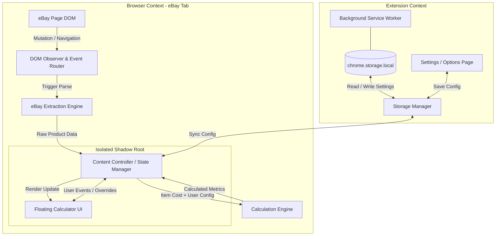
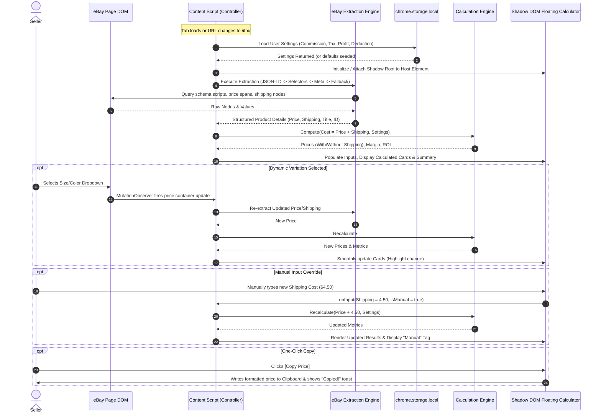
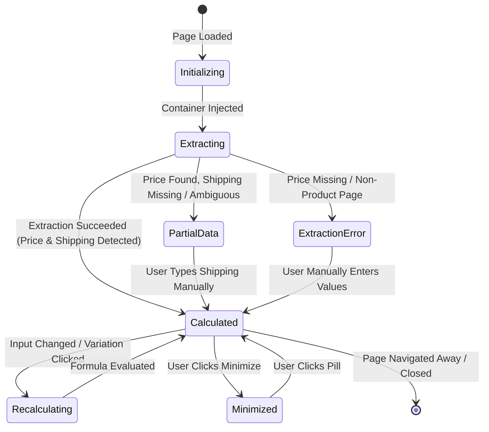

# Technical Architecture Document: eBay to Amazon Profit Calculator

## 1. Executive Architectural Overview

The **eBay to Amazon Profit Calculator** is a modular, event-driven, client-only Google Chrome extension architected under the **Manifest V3** specification. It follows a clean architecture pattern where core business math, DOM parsing heuristics, UI presentation, and persistent storage are decoupled into isolated modules.



---

## 2. Manifest V3 Component Roles & Responsibilities

| Component | Execution Context | Permissions / Lifecycle | Primary Responsibility |
| :--- | :--- | :--- | :--- |
| **`content.js`** | eBay Tab (Isolated World) | Injected at `document_idle` on eBay domains | Coordinates parsing, hosts the Shadow DOM container, and maintains runtime state. |
| **`ebay-parser.js`** | Content Script Module | Local execution | Executes multi-tiered extraction pipeline (JSON-LD, Microdata, DOM selectors, regex). |
| **`calculator-engine.js`** | Pure JS Module | Standalone (Node/Browser compatible) | Implements pure algebraic formulas for Amazon prices, margins, and ROI with zero side effects. |
| **`storage.js`** | Content & Options Context | Wraps `chrome.storage.local` | Centralized settings schema, default fallbacks, and reactive event broadcasting. |
| **`background.js`** | Service Worker Context | Ephemeral / Event-driven | Handles extension installation, default storage seeding, and tab navigation lifecycle. |
| **`settings.html / js`** | Extension Tab Context | Independent UI page | Allows user to customize commission rates, taxes, target profit, and shipping deduction. |

---

## 3. Data Flow & Sequence Diagram



---

## 4. Multi-Tiered eBay Extraction Engine

To maintain high resilience against eBay's frequent A/B testing and localized DOM updates, the extraction engine utilizes a prioritized four-tier fallback mechanism:


### Extraction Specifications
1. **Tier 1 (JSON-LD Structured Data):**
   - Targets `<script type="application/ld+json">`.
   - Traverses `@type: "Product"` or nested `"offers"`.
   - Extracts canonical `price`, `priceCurrency`, and `name`.
2. **Tier 2 (eBay-Specific DOM Selectors):**
   - **Price Targets:**
     - `.x-price-primary .ux-textspans`
     - `[data-testid="x-price-primary"] span`
     - `#prcIsum`, `#mm-saleDscPrc`, `.vi-bin-primary-price__sub`
   - **Shipping Targets:**
     - `[data-testid="x-shipping-cost"] .ux-textspans`
     - `.ux-labels-values--shipping .ux-textspans--BOLD`
     - `#fshippingCost`, `#shippingSection`
   - **Title Targets:**
     - `.x-item-title__mainTitle .ux-textspans`
     - `h1.x-item-title`
     - `#itemTitle`
   - **Item ID & URL:**
     - URL regex: `/\/itm\/(?:[^\/]+\/)?(\d+)/`
     - Canonical link: `link[rel="canonical"]`
3. **Tier 3 (Meta Tags):**
   - `meta[property="og:price:amount"]`
   - `meta[name="twitter:data1"]`
4. **Tier 4 (Text Normalization & Fallbacks):**
   - Handles localized currency formats (e.g., `$1,299.99`, `£45.00`, `19,99 €`).
   - Normalizes comma decimal separators into standard floats.

---

## 5. Calculation Engine Specifications

The mathematical engine is pure, stateless, and deterministic. It performs computations at full floating-point precision and formats numbers strictly at the presentation boundary.

### Core Variables & Formula Definitions
- $C$: Total eBay Product Cost ($C = \text{Product Price} + \text{Shipping Cost}$)
- $R$: Amazon Referral Commission Percentage as a decimal (e.g., $15\% = 0.15$)
- $T$: Sales Tax Percentage as a decimal (e.g., $9\% = 0.09$)
- $P$: Target Profit in dollars (e.g., $\$12.00$)
- $D$: Shipping Deduction in dollars (e.g., $\$9.98$)

### Algebraic Formulas

1. **Amazon Selling Price With Shipping ($S$):**
   $$S = \frac{C + P}{1 - R - T}$$
   *Validation Rule:* $1 - R - T > 0 \implies R + T < 1.0$ (Must be strictly less than 100%).

2. **Amazon Selling Price Without Shipping ($S_{\text{no\_ship}}$):**
   $$S_{\text{no\_ship}} = S - D$$
   *Important Boundary Invariant:* The deduction $D$ is **strictly** an offset applied to the final price display. It must never be subtracted from $C$ or $P$ during intermediate math.

3. **Estimated Profit ($\Pi$):**
   $$\Pi = S \times (1 - R - T) - C$$
   *Verification:* Mathematically equals $P$ (within floating point rounding).

4. **Profit Margin Percentage ($M$):**
   $$M = \left(\frac{\Pi}{S}\right) \times 100$$

5. **Return on Investment Percentage ($\text{ROI}$):**
   $$\text{ROI} = \left(\frac{\Pi}{C}\right) \times 100$$

---

## 6. Floating Calculator UI Architecture (Shadow DOM)

To guarantee that eBay's global stylesheets (or other injected scripts) do not alter the calculator's appearance, and to ensure extension styles never distort eBay's native interface, the calculator is mounted inside an isolated **Shadow Root**.

```
HTML Document (eBay)
└── <body>
    └── <div id="ebay-amazon-profit-calc-host"> (Host Container)
        └── #shadow-root (open)
            ├── <style> (Scoped CSS with CSS Variables & Reset)
            └── <div class="eapc-container draggable">
                ├── Header (Title, Drag Handle, Minimize/Close)
                ├── Section 1: Product Information
                ├── Section 2: Calculation Settings Quick Display
                ├── Section 3: Amazon Selling Price Cards (With / Without Shipping)
                ├── Section 4: Profit Summary Grid (Margin, ROI, Est Profit)
                └── Section 5: Action Buttons & Toast Container
```

### Key UI Subsystems
1. **Host Isolation:** An idempotent custom host element (`#ebay-amazon-profit-calc-host`) is appended to `document.body`.
2. **Dragging Subsystem:** Mouse event listeners (`pointerdown`, `pointermove`, `pointerup`) operate on the header, translating coordinates within `window.innerWidth` and `window.innerHeight` bounds with position persistence in `sessionStorage`.
3. **Pill / Minimized State:** The calculator collapses to a discrete floating pill displaying the live estimated profit (e.g., `💰 $12.00`), anchored to the viewport edge.

---

## 7. Storage Management & Configuration Schema

All user preferences are managed through a centralized storage adapter wrapping `chrome.storage.local`.

### Configuration Schema
```typescript
interface UserSettings {
  amazonCommissionRate: number; // Default: 15.0 (%)
  sellTaxRate: number;          // Default: 9.0 (%)
  targetProfitAmount: number;   // Default: 12.00 ($)
  shippingDeduction: number;    // Default: 9.98 ($)
  uiPosition?: { x: number; y: number };
  isMinimized?: boolean;
}
```

### Reactive Storage Sync
The content script listens to `chrome.storage.onChanged`:
```javascript
chrome.storage.onChanged.addListener((changes, areaName) => {
  if (areaName === 'local') {
    // Update in-memory configuration
    // Trigger immediate UI recalculation
  }
});
```
This guarantees that changing settings in the Extension Options page immediately updates any open eBay listing tabs without requiring a browser refresh.

---

## 8. Architectural Decision Records (ADRs)

### ADR-01: Floating Calculator Overlay vs. Browser Action Popup
- **Context:** The extension needs to present calculated prices to users as they research listings.
- **Decision:** Implement a **Floating In-Page Calculator** inside a Shadow DOM, accompanied by an optional browser action popup for quick settings.
- **Rationale:** A browser action popup closes immediately when the user clicks anywhere on the eBay page to inspect photos, read feedback, or copy descriptions. A floating calculator remains contextually visible, allows continuous comparison while browsing, and supports one-click copying without losing state.

### ADR-02: Safe Strategy for Dynamic Prices & Product Variations
- **Context:** eBay listings with variations (e.g., shoe sizes, apparel colors) asynchronously update prices via client-side AJAX/fetch without reloading the page.
- **Decision:** Attach a debounced `MutationObserver` (250ms debounce) targeting the main price and shipping containers (`[data-testid="x-price-primary"]`, `.x-price-primary`, `#prcIsum`).
- **Rationale:** Polling with `setInterval` wastes CPU cycles and battery. A debounced `MutationObserver` triggers only when DOM mutations occur and cancels intermediate calculations until the DOM stabilizes.

### ADR-03: Coexistence of Manual Input and Automatic Extraction
- **Context:** Automatic extraction may occasionally encounter non-standard or missing shipping rates (e.g., "Contact seller", freight, or pick-up only).
- **Decision:** Introduce a state flag `isManualOverride: { price: boolean, shipping: boolean }`.
- **Rationale:** If the user manually edits the input field, the extraction observer preserves user-typed values until navigation to a completely new eBay item occurs (detected by Item ID change). Visually, manual fields display an "Edited" badge with a "Re-detect" revert icon.

### ADR-04: Multi-Tab Settings Synchronization
- **Context:** Users may open multiple eBay tabs simultaneously while modifying settings on the options page.
- **Decision:** Use `chrome.storage.local` combined with `chrome.storage.onChanged`.
- **Rationale:** `chrome.storage.local` triggers cross-tab events natively, ensuring seamless synchronization without complex background message routing.

### ADR-05: Content Script and Service Worker Communication
- **Context:** Need minimal overhead communication between content scripts and background tasks.
- **Decision:** Content scripts operate autonomously using local DOM parsing and local storage. Service workers are utilized strictly for install-time storage seeding and external navigation event routing.
- **Rationale:** MV3 service workers terminate after 30 seconds of inactivity. Relying on service workers for continuous calculation would cause unnecessary wakeups and latency spikes.

### ADR-06: Principle of Least Privilege (Chrome Permissions)
- **Context:** The extension must be secure, lightweight, and trustworthy.
- **Decision:** Request only `storage` permission and restrict host permissions strictly to eBay domains:
  - `*://*.ebay.com/itm/*`
  - `*://*.ebay.co.uk/itm/*`
  - `*://*.ebay.ca/itm/*`
  - `*://*.ebay.com.au/itm/*`
  - `*://*.ebay.de/itm/*`
- **Rationale:** Omits `<all_urls>`, `webRequest`, `cookies`, or arbitrary script injection. Prevents broad security warnings during installation.

### ADR-07: Prevention of Duplicate Floating Calculator Instances
- **Context:** Fast navigation, client-side re-renders, or re-injections could result in multiple calculators injected into the page.
- **Decision:** Enforce a strict singleton check on the host element ID (`#ebay-amazon-profit-calc-host`) before DOM attachment.
- **Rationale:** If the element already exists, the injection routine aborts and returns the existing instance controller.

### ADR-08: Handling eBay Client-Side SPA Navigation
- **Context:** Modern eBay pages use the HTML5 History API (`pushState`/`replaceState`) when browsing related products.
- **Decision:** Wrap `history.pushState` and `history.replaceState` in the window context, listen to `popstate`, and verify Item ID changes.
- **Rationale:** Ensures clean reset of manual overrides and triggers fresh extraction when an in-page navigation occurs.

---

## 9. Error Handling & State Transition Matrix



### State Definitions & Safe Boundaries
- **`EXTRACTION_ERROR`:** Display clean message *"Price could not be auto-detected. Enter values manually to calculate."*
- **`DIVISION_BY_ZERO_GUARD`:** If user sets Commission (e.g. 50%) + Tax (50%) = 100%, denominator is 0. Guard detects $1 - R - T \le 0$ and displays an inline warning banner: *"Commission + Tax must be less than 100%"*, disabling price calculations safely.
- **`CLIPBOARD_ERROR`:** If `navigator.clipboard.writeText` fails (e.g., document not focused), fall back to `document.execCommand('copy')` via a hidden input inside the Shadow Root.
