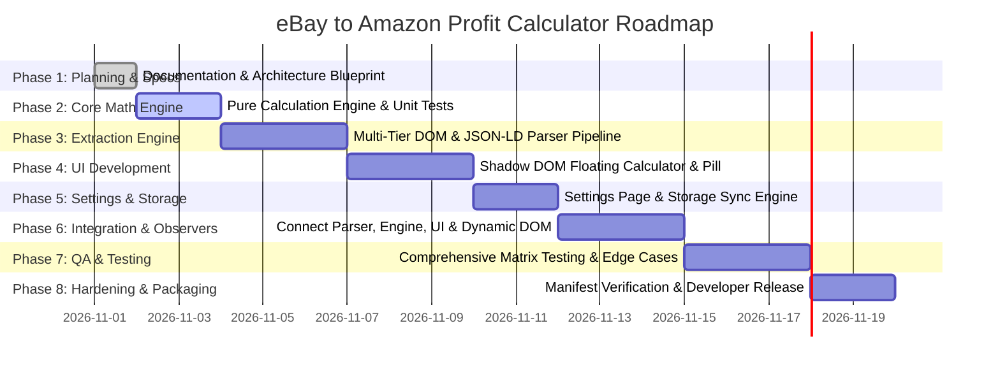

# Product Development Plan: eBay to Amazon Profit Calculator

## 1. Executive Summary & Project Objectives

The **eBay to Amazon Profit Calculator** is a Manifest V3 Google Chrome extension engineered for e-commerce entrepreneurs, dropshippers, and retail arbitrageurs. It provides instant, automated, on-page price modeling directly inside eBay listing pages. By extracting product details and executing precise reverse-margin algebra, it empowers sellers to make split-second purchasing decisions with complete mathematical certainty.

### Key Objectives
1. **Eliminate Friction:** Replace external spreadsheet calculators with a contextual, floating overlay on eBay Product Details Pages.
2. **Prevent Costly Pricing Errors:** Factor in platform referral fees, state sales tax provisions, and shipping deductions to ensure target net margins are guaranteed.
3. **Handle Dynamic Listings:** Seamlessly detect price and shipping shifts when users toggle size, color, condition, or multi-quantity variations.
4. **Maintain Privacy & Ultra-Low Overhead:** Execute 100% of calculations and parsing locally in-browser without external network calls or tracking.
5. **Controlled Git Workflow:** Enforce disciplined source code management with explicit pre-push security gates and user authorization.

---

## 2. Problem Statement

Cross-platform sellers frequently source products from eBay to fulfill demand or list on Amazon Marketplace. However, determining a viable selling price involves complex fee structures:
- **Amazon Referral Fees:** Typically 15% of the total transaction value.
- **Sales Tax Impacts:** Approximately 9% (or customized regional tax).
- **Shipping Allowances:** Balancing "Free Shipping" listings on Amazon by factoring in standard shipping allowances ($9.98).
- **Human Math Errors:** Manual mental math or switching tabs to Excel introduces latency and risks underpricing, resulting in margin erosion or net losses.
- **eBay DOM Instability & Currency Differences:** eBay continually tests diverse desktop layouts, currency presentations, and variation pickers, causing fragile single-selector tools to fail silently or misinterpret currencies.

---

## 3. Target Users & User Personas

| Persona | Role | Core Need | Key Frustration |
| :--- | :--- | :--- | :--- |
| **"Arbitrage Alex"** | Online Arbitrageur | Evaluates 200+ listings daily across eBay to list on Amazon. | Switching browser tabs to calculate net margin on each item. |
| **"Dropshipping Dana"** | E-commerce Merchant | Lists eBay items on Amazon with free shipping; needs both prices. | Forgetting to deduct standard shipping from the final list price. |
| **"Sourcing Sam"** | Part-time Reseller | Buys variations (shoes, apparel); needs instant updates when sizes change. | Extensions failing to update or overwriting manual inputs when dropdowns change. |

---

## 4. User Stories

1. **US-01 (Auto Detection):** *As a seller*, when I land on an eBay product details page, *I want* the extension to automatically detect the item title, item price, and shipping cost *so that* I don't have to retype information manually.
2. **US-02 (Profit Modeling):** *As a seller*, *I want* to see the exact Amazon selling price needed to make my target dollar profit (e.g., $12.00) after Amazon commissions (15%) and sales tax (9%) are paid.
3. **US-03 (Dual Price Options):** *As a seller*, *I want* to see two distinct prices—one "With Shipping" and one "Without Shipping" (reduced by $9.98)—*so that* I can choose whether to charge customer shipping or offer free shipping.
4. **US-04 (One-Click Copy):** *As a seller*, *I want* dedicated copy buttons for each selling price that place the formatted number directly into my clipboard *so that* I can paste it instantly into Amazon Seller Central, with reliable fallback and no false success messages.
5. **US-05 (Variation Adaptability):** *As a seller*, when I select a different size or color dropdown on eBay, *I want* the calculator to update the price and recalculate instantly without refreshing the page, while preserving any manual overrides I set.
6. **US-06 (Independent Manual Correction):** *As a seller*, if eBay displays ambiguous shipping (e.g., "See details" or "Freight"), *I want* an editable field to type the shipping cost manually without locking the price field.
7. **US-07 (Custom Settings):** *As a seller*, *I want* to customize my default commission rate, tax percentage, target profit, and shipping deduction *so that* the math matches my business model and seller tier.
8. **US-08 (Non-Intrusive Viewport):** *As a seller*, *I want* to drag or minimize the floating calculator *so that* it does not block item images, descriptions, or seller ratings.

---

## 5. Functional Requirements (FR)

- **FR-1 (Page Detection & Declarative Scope):** Detect if the current active tab is an eBay product page (`/itm/`) across supported eBay top-level domains (`.com`, `.co.uk`, `.ca`, `.com.au`, `.de`) using declarative `content_scripts.matches`.
- **FR-2 (Product Data Extraction):** Extract Product Title, Listed Price, Shipping Cost, Total Cost (`Price + Shipping`), Canonical URL, and eBay Item ID.
- **FR-3 (Multi-Tier Parsing Pipeline):** Extract data in prioritized order: JSON-LD structured data $\rightarrow$ Targeted DOM selectors $\rightarrow$ OpenGraph/Twitter meta tags $\rightarrow$ Sanitized text fallback regex.
- **FR-4 (Currency Parsing & Normalization):**
  - Identify currency symbol/code (USD, GBP, EUR, CAD, AUD) before normalization.
  - Support US format (`1,234.56`) and European format (`1.234,56`) with single-separator heuristics.
  - Never assume an unknown currency is USD; do not convert currencies without an explicit exchange rate; pause calculation on unknown currencies and prompt manual entry.
- **FR-5 (Three-State Shipping Model):**
  - Implement `FREE` ($0.00), `KNOWN` (valid amount $>0$), and `UNKNOWN` (missing/ambiguous).
  - Never treat `UNKNOWN` as $0.00. Pause calculations when shipping is `UNKNOWN`.
- **FR-6 (Dual Independent Manual Overrides):**
  - Maintain separate override states for `price` and `shipping`.
  - Manual values must not be overwritten by automatic DOM extraction.
  - Automatic extraction continues updating non-overridden fields.
  - Provide a "Re-detect" action per field. Reset overrides only on genuine Item ID change.
- **FR-7 (Mathematical Engine & Validation):**
  - Compute Selling Price With Shipping: $S = (C + P) / (1 - R - T)$
  - Compute Selling Price Without Shipping: $S_{\text{no\_ship}} = S - D$
  - Compute Estimated Profit: $\Pi = S \times (1 - R - T) - C$
  - Compute Profit Margin (%): $(\Pi / S) \times 100$
  - Compute ROI (%): $(\Pi / C) \times 100$ (Returns `"N/A (Zero Cost)"` if $C = 0$)
  - Enforce boundary policies: Reject $C < 0$, halt if $R + T \ge 100\%$, warn on negative target profit ($P < 0$), clamp negative second selling price ($S < D$) with warning label, and guard against `NaN`/$\pm\infty$.
- **FR-8 (Clipboard Integration & Failure Handling):**
  - Primary write via `navigator.clipboard.writeText`; fallback via `document.execCommand('copy')`.
  - Display "Copied!" toast only upon confirmed success. Display error toast if copying fails.
- **FR-9 (Dynamic Variation Handling):**
  - Attach targeted `MutationObserver` exclusively to price/shipping container nodes.
  - Throttle with 250ms trailing debounce timer. Suppress duplicate events. Disconnect on teardown.
- **FR-10 (SPA Navigation Lifecycle):**
  - Multi-strategy detection (`popstate`/`hashchange`, `<head>` title/canonical observer, background messaging, 500ms URL poll).
  - Teardown protocol: disconnect observers, clear timers, clear cache, and reset manual overrides on Item ID change.
- **FR-11 (Persistent Configuration):**
  - Store Amazon Commission % (Default: `15.0%`), Sell Tax % (Default: `9.0%`), Target Profit $ (Default: `$12.00`), and Shipping Deduction $ (Default: `$9.98`) in `chrome.storage.local`.
  - Listen to `chrome.storage.onChanged` to sync across open tabs reactively.
- **FR-12 (Shadow DOM Encapsulation):**
  - Render calculator inside an isolated `attachShadow({ mode: 'open' })` on `#ebay-amazon-profit-calc-host`.
  - Support viewport dragging and collapsible minimized pill state.

---

## 6. Non-Functional Requirements (NFR)

- **NFR-1 (Performance & Latency):** Parsing and initial UI injection $< 150\text{ms}$; calculation execution $< 1\text{ms}$.
- **NFR-2 (Memory & Lifecycle):** Zero memory leaks. All observers, listeners, and timers must be disconnected on teardown.
- **NFR-3 (Security & Permissions):** Compliance with Chrome MV3 CSP (no inline scripts, no `eval`). Request only `storage` in `permissions`. Avoid broad `host_permissions`.
- **NFR-4 (Reliability & Robustness):** Graceful error handling; clear validation states; zero silent failures.
- **NFR-5 (Cross-Platform Compatibility):** Fully compatible with Chromium 100+ (Chrome, Brave, Edge, Opera).

---

## 7. Feature Boundaries (In-Scope vs. Out-of-Scope)

```
┌────────────────────────────────────────────────────────────────────────┐
│                          IN-SCOPE (MVP)                                │
│                                                                        │
│  ✓ Automatic eBay Details extraction (JSON-LD + DOM Fallbacks)         │
│  ✓ Currency parsing & disambiguation (US, European formats)            │
│  ✓ Three-State Shipping Model (FREE, KNOWN, UNKNOWN)                   │
│  ✓ Dual Independent Manual Overrides (Price & Shipping)                │
│  ✓ Instant Formula Calculation (With / Without Shipping)               │
│  ✓ Target Profit, Estimated Profit, Margin %, ROI %                     │
│  ✓ Shadow DOM Floating Calculator (Draggable, Minimizable)             │
│  ✓ Dynamic Variation Price Mutation Observer (Targeted, Debounced)     │
│  ✓ Multi-Strategy SPA Navigation & Full Teardown Protocol              │
│  ✓ Options Page with Local Storage Persistence & Reactive Sync         │
│  ✓ Reliable Clipboard Copy with Fallback and Error Handling            │
│  ✓ Controlled Git Workflow with Pre-Push Security Gates                │
└────────────────────────────────────┬───────────────────────────────────┘
                                     │
                                     ▼
┌────────────────────────────────────────────────────────────────────────┐
│                     OUT-OF-SCOPE (FUTURE RELEASES)                     │
│                                                                        │
│  ✗ Amazon ASIN / Product Matcher via Scraping or API                   │
│  ✗ Live Amazon Buy Box / Competitor Price Retrieval                    │
│  ✗ Automated Unauthenticated Currency Conversion                       │
│  ✗ Bulk Extraction or Multi-Tab Scraping                               │
│  ✗ Historical Price Tracking or Charts                                 │
│  ✗ CSV / Excel Batch Export                                            │
│  ✗ External Database, Cloud Sync, or User Accounts                     │
│  ✗ Auto-listing on Amazon Seller Central via SP-API                    │
└────────────────────────────────────────────────────────────────────────┘
```

---

## 8. Development Phases & Roadmap



---

## 9. Acceptance Criteria & Definition of Done (DoD)

### Phase 1 Acceptance Criteria
- [x] All 10 architectural and planning documents created, corrected, and audited.
- [x] Exact algebraic formulas unified across all documents.
- [x] Currency parsing, three-state shipping, dual overrides, and SPA navigation fully specified.
- [x] Controlled Git workflow established in `AGENTS.md`.

### Overall Extension Definition of Done (DoD)
1. **Accurate:** Calculations match established test cases (TC-01 to TC-25) within $\pm\$0.01$ precision.
2. **Resilient:** Tested against diverse eBay listings and variations without memory leaks or stale data.
3. **Encapsulated:** Zero CSS interference via Shadow DOM encapsulation.
4. **Least Privilege:** Declarative match patterns only; permissions restricted strictly to `storage`.
5. **Secure:** 100% compliant with MV3 CSP; zero remote code; controlled Git workflow verified.
