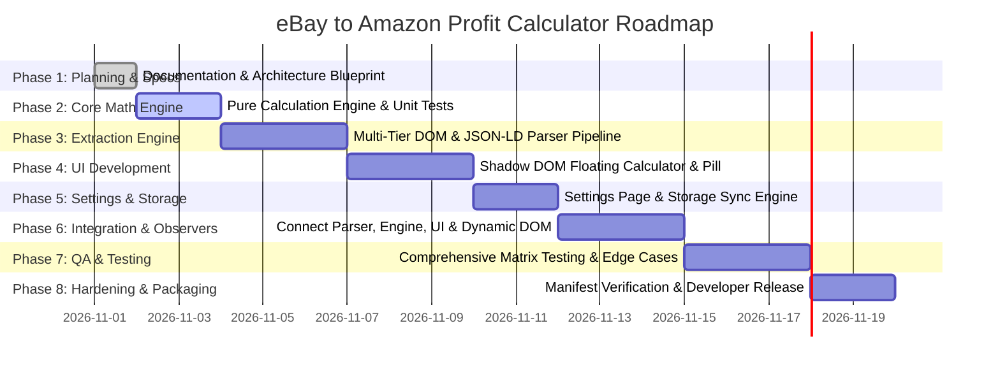

# Product Development Plan: eBay to Amazon Profit Calculator

## 1. Executive Summary & Project Objectives

The **eBay to Amazon Profit Calculator** is a Manifest V3 Google Chrome extension engineered for e-commerce entrepreneurs, dropshippers, and retail arbitrageurs. It provides instant, automated, on-page price modeling directly inside eBay listing pages. By extracting product details and executing precise reverse-margin algebra, it empowers sellers to make split-second purchasing decisions with complete mathematical certainty.

### Key Objectives
1. **Eliminate Friction:** Replace external spreadsheet calculators with a contextual, floating overlay on eBay Product Details Pages.
2. **Prevent Costly Pricing Errors:** Factor in platform referral fees, state sales tax provisions, and shipping deductions to ensure target net margins are guaranteed.
3. **Handle Dynamic Listings:** Seamlessly detect price and shipping shifts when users toggle size, color, condition, or multi-quantity variations.
4. **Maintain Privacy & Ultra-Low Overhead:** Execute 100% of calculations and parsing locally in-browser without external network calls or tracking.

---

## 2. Problem Statement

Cross-platform sellers frequently source products from eBay to fulfill demand or list on Amazon Marketplace. However, determining a viable selling price involves complex fee structures:
- **Amazon Referral Fees:** Typically 15% of the total transaction value.
- **Sales Tax Impacts:** Approximately 9% (or customized regional tax).
- **Shipping Allowances:** Balancing "Free Shipping" listings on Amazon by factoring in standard shipping allowances ($9.98).
- **Human Math Errors:** Manual mental math or switching tabs to Excel introduces latency and risks underpricing, resulting in margin erosion or net losses.
- **eBay DOM Instability:** eBay continually tests diverse desktop layouts, currency presentations, and variation pickers, causing fragile single-selector tools to fail silently.

---

## 3. Target Users & User Personas

| Persona | Role | Core Need | Key Frustration |
| :--- | :--- | :--- | :--- |
| **"Arbitrage Alex"** | Online Arbitrageur | Evaluates 200+ listings daily across eBay to list on Amazon. | Switching browser tabs to calculate net margin on each item. |
| **"Dropshipping Dana"** | E-commerce Merchant | Lists eBay items on Amazon with free shipping; needs both prices. | Forgetting to deduct standard shipping from the final list price. |
| **"Sourcing Sam"** | Part-time Reseller | Buys variations (shoes, apparel); needs instant updates when sizes change. | Extensions failing to update when an eBay dropdown changes. |

---

## 4. User Stories

1. **US-01 (Auto Detection):** *As a seller*, when I land on an eBay product details page, *I want* the extension to automatically detect the item title, item price, and shipping cost *so that* I don't have to retype information manually.
2. **US-02 (Profit Modeling):** *As a seller*, *I want* to see the exact Amazon selling price needed to make my target dollar profit (e.g., $12.00) after Amazon commissions (15%) and sales tax (9%) are paid.
3. **US-03 (Dual Price Options):** *As a seller*, *I want* to see two distinct prices—one "With Shipping" and one "Without Shipping" (reduced by $9.98)—*so that* I can choose whether to charge customer shipping or offer free shipping.
4. **US-04 (One-Click Copy):** *As a seller*, *I want* dedicated copy buttons for each selling price that place the formatted number directly into my clipboard *so that* I can paste it instantly into Amazon Seller Central.
5. **US-05 (Variation Adaptability):** *As a seller*, when I select a different size or color dropdown on eBay, *I want* the calculator to update the price and recalculate instantly without refreshing the page.
6. **US-06 (Manual Correction):** *As a seller*, if eBay displays ambiguous shipping (e.g., "See details" or "Freight"), *I want* an editable field to type the shipping cost manually and instantly see the updated calculations.
7. **US-07 (Custom Settings):** *As a seller*, *I want* to customize my default commission rate, tax percentage, target profit, and shipping deduction *so that* the math matches my business model and seller tier.
8. **US-08 (Non-Intrusive Viewport):** *As a seller*, *I want* to drag or minimize the floating calculator *so that* it does not block item images, descriptions, or seller ratings.

---

## 5. Functional Requirements (FR)

- **FR-1 (Page Detection):** Detect if the current active tab is an eBay product page (`/itm/` or item detail pattern) across all major eBay top-level domains (`.com`, `.co.uk`, `.ca`, `.com.au`, `.de`).
- **FR-2 (Product Data Extraction):** Extract:
  - Product Title
  - Listed Price
  - Shipping Cost (explicitly distinguishing between $0 Free Shipping and missing shipping)
  - Total Cost (`Price + Shipping`)
  - Canonical Product URL
  - eBay Item ID
- **FR-3 (Multi-Tier Parsing Pipeline):** Extract data in prioritized fallback order:
  1. JSON-LD schema.org script blocks (`itemprop` / `@type: Product`)
  2. Targeted DOM element selectors
  3. OpenGraph / Twitter meta tags
  4. Robust regex text parsing on primary container nodes
- **FR-4 (Manual Overrides):** Permit the user to edit Price and Shipping inputs directly in the UI. Overrides must trigger immediate recalculation and visually flag the field as manually modified.
- **FR-5 (Mathematical Engine):**
  - Compute Selling Price With Shipping: `Selling Price = (C + P) / (1 - R - T)`
  - Compute Selling Price Without Shipping: `Price Without Shipping = Selling Price - D`
  - Compute Estimated Profit: `Estimated Profit = Selling Price * (1 - R - T) - C`
  - Compute Profit Margin (%): `(Estimated Profit / Selling Price) * 100`
  - Compute ROI (%): `(Estimated Profit / Total Product Cost) * 100`
- **FR-6 (Clipboard Integration):** Provide distinct copy triggers for both selling prices with visual feedback (e.g., "Copied!" tooltip for 1500ms).
- **FR-7 (Variation Observers):** Utilize a debounced `MutationObserver` targeting price and shipping containers to detect asynchronous listing updates (e.g., variation dropdown changes).
- **FR-8 (Persistent Configuration):** Allow customization of:
  - Amazon Commission % (Default: `15.0%`)
  - Sell Tax % (Default: `9.0%`)
  - Target Profit $ (Default: `$12.00`)
  - Shipping Deduction $ (Default: `$9.98`)
  Settings must be saved in `chrome.storage.local` and synchronize reactively across all tabs.
- **FR-9 (Floating UI & Encapsulation):** Render the calculator inside an isolated `attachShadow({ mode: 'open' })` root on the page to prevent eBay style leakage.
- **FR-10 (UI State Controls):** Allow the user to drag the calculator within viewport boundaries and collapse it into a compact floating pill/badge.

---

## 6. Non-Functional Requirements (NFR)

- **NFR-1 (Performance & Latency):**
  - Parsing and initial UI injection must complete in less than 150ms after DOM readiness (`document_idle`).
  - Mathematical calculations must execute in under 1ms.
- **NFR-2 (Memory & Lifecycle):**
  - The extension must observe DOM mutations cleanly without memory leaks.
  - Event listeners and observers must be disconnected when the URL navigates away.
- **NFR-3 (Security & Permissions):**
  - Compliance with Chrome Manifest V3 and strict Content Security Policy (no `eval`, no external script injection).
  - Minimal host permissions: restricted strictly to eBay product page patterns (`*://*.ebay.com/itm/*`, etc.).
  - Zero network telemetry or outbound external HTTP requests.
- **NFR-4 (Reliability & Robustness):**
  - Graceful degradation: never crash or throw unhandled exceptions if DOM elements are missing or rearranged.
  - Strict input validation: prevent division by zero or negative denominators if `Commission + Tax >= 100%`.
- **NFR-5 (Cross-Platform Browser Compatibility):** Fully compatible with Google Chrome, Brave, Microsoft Edge, and Opera (Chromium 100+).

---

## 7. Feature Boundaries (In-Scope vs. Out-of-Scope)

```
┌────────────────────────────────────────────────────────────────────────┐
│                          IN-SCOPE (MVP)                                │
│                                                                        │
│  ✓ Automatic eBay Details extraction (JSON-LD + DOM Fallbacks)         │
│  ✓ Instant Formula Calculation (With / Without Shipping)               │
│  ✓ Target Profit, Estimated Profit, Margin %, ROI %                     │
│  ✓ Shadow DOM Floating Calculator (Draggable, Minimizable)             │
│  ✓ Manual Input Override & Inline Validation                           │
│  ✓ Dynamic Variation Price Mutation Observer                           │
│  ✓ Options/Settings Page with Local Storage Persistence                │
│  ✓ One-Click Clipboard Copying with Visual Feedback                    │
└────────────────────────────────────┬───────────────────────────────────┘
                                     │
                                     ▼
┌────────────────────────────────────────────────────────────────────────┐
│                     OUT-OF-SCOPE (FUTURE RELEASES)                     │
│                                                                        │
│  ✗ Amazon ASIN / Product Matcher via Scraping or API                   │
│  ✗ Live Amazon Buy Box / Competitor Price Retrieval                    │
│  ✗ Bulk Extraction or Multi-Tab Scraping                               │
│  ✗ Historical Price Tracking or Charts                                 │
│  ✗ CSV / Excel Batch Export                                            │
│  ✗ External Database, Cloud Sync, or User Accounts                     │
│  ✗ Auto-listing on Amazon Seller Central via SP-API                    │
└────────────────────────────────────────────────────────────────────────┘
```

---

## 8. Development Phases & Roadmap



---

## 9. Milestones

| Milestone | Deliverable | Success Criteria |
| :--- | :--- | :--- |
| **M1: Architecture Sign-Off** | All 10 documentation files completed & audited. | 100% requirements verified; no open blockers. |
| **M2: Verified Math Engine** | `calculator-engine.js` with comprehensive test suite. | All primary and boundary test cases pass with full float precision. |
| **M3: Robust Extraction Pipeline** | `ebay-parser.js` handling standard & dynamic pages. | Extracts price/shipping across 10 distinct eBay listing types with fallbacks. |
| **M4: Functional Floating UI** | Shadow DOM injection and interactive calculator. | UI renders cleanly without breaking eBay page layout or inheriting styles. |
| **M5: Settings & Storage Sync** | Options page and reactive storage events. | Config changes propagate immediately to open eBay tabs. |
| **M6: Complete Integration** | End-to-end working extension in Chrome. | Dropdowns update price in real-time; clipboard copies exact values. |
| **M7: QA Verification** | Full test matrix execution and audit report. | Zero critical defects; manual and automated test pass rate 100%. |
| **M8: Final Package** | Clean, production-ready unpackable build. | Successfully installs in Chrome Developer Mode; clean console output. |

---

## 10. Technical Constraints & Risks

| Risk / Constraint | Likelihood | Impact | Mitigation Strategy |
| :--- | :---: | :---: | :--- |
| **eBay DOM Structure Changes** | High | High | Primary extraction relies on schema.org JSON-LD; secondary DOM fallback uses flexible multi-selector matching. |
| **eBay Single-Page / AJAX Navigation** | Medium | Medium | Implement URL change detection (via `history.pushState` hooks + `MutationObserver` on document title/location). |
| **CSS Bleeding into / from eBay** | High | High | Wrap the entire extension UI in a native `ShadowRoot` with complete CSS reset tokens. |
| **Unreliable / Missing Shipping Cost** | High | Medium | Explicitly mark missing shipping as `N/A`, highlight the input in warning amber, and prompt manual entry without guessing. |
| **Invalid Mathematical Inputs** | Low | High | Enforce validation: `Commission + Tax < 100%` and positive numbers only; display descriptive error toasts instead of `NaN`. |

---

## 11. Acceptance Criteria & Definition of Done (DoD)

### Phase 1 Acceptance Criteria
- [x] All 10 architectural and planning documents created and cross-referenced.
- [x] Exact algebraic formulas unified across all documents.
- [x] Comprehensive test case data verified against mathematical specifications.
- [x] Explicit Git version control guidelines active and verified.

### Overall Extension Definition of Done (DoD)
1. **Accurate:** Calculations match established test cases within ±$0.01 precision.
2. **Resilient:** Tested against 15+ real-world eBay listings (Single price, variations, auction, free shipping, freight).
3. **Encapsulated:** Zero CSS interference between eBay and the calculator overlay.
4. **Lightweight:** Extension package size < 1MB; zero external network requests.
5. **Audited:** All code adheres strictly to Manifest V3 CSP and Chrome Web Store policies.
